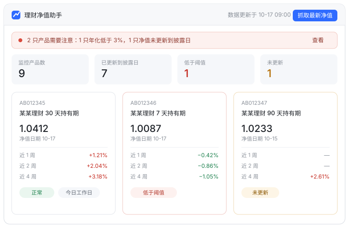
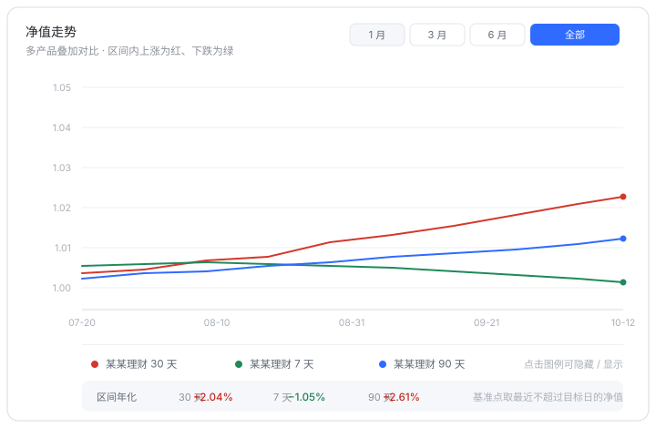
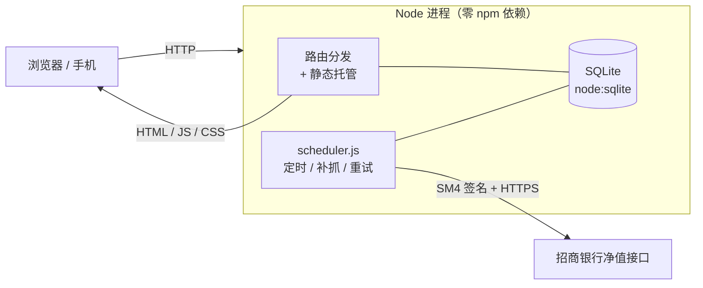

<div align="center">

# 理财净值助手 · 服务器版

**把自己的理财净值监控，从「每天手点一遍」变成「每天 9 点准时躺到手机里」。**

一个零依赖的 Node 服务 + 一套 React 界面，跑在你自己的服务器上，
定时抓取、自动补抓、失败重试、多设备共享同一份数据。

> **目前只支持招商银行**的理财产品净值。其他银行、基金、券商的自动抓取暂未适配，
> 详见 [支持范围](#支持范围目前只支持招商银行)。

[](https://nodejs.org)
[](#为什么后端零依赖)
[](https://vitejs.dev)
[](https://react.dev)
[](#支持范围目前只支持招商银行)
[](./LICENSE)

</div>

---

## 你是不是也这样看理财

> 早上想起来，打开 App，一个个产品点进去看净值，拿计算器算年化，
> 再想想「这个是不是已经跌破我设的线了」……第二天，重复一遍。

产品一多就没法维护，更别说发现**哪只悄悄掉队了**。而浏览器插件方案又会撞上一堵墙：
**招商银行**的数据接口不允许跨域，浏览器里根本发不出请求。

这个项目解决的就是这两件事——**抓取搬到服务端**，**判断交给程序**，你只看结论。

<br>

<table>
<tr>
<td width="50%">

**❌ 以前**

- 逐个产品点开，手动抄净值
- 自己按日期找基准点算年化
- 忘了哪只该披露却没更新
- 电脑上录的数据，手机上还得再来一遍

</td>
<td width="50%">

**✅ 现在**

- 每天定时自动抓全部监控中产品（默认 09:00，时间在页面里改）
- 近 1/2/4 周年化自动算，带基准日与天数
- 「未更新」自动标红，跌破阈值自动置顶
- 电脑、手机、平板访问同一个地址，数据同一份

</td>
</tr>
</table>

---

## 支持范围：目前只支持招商银行

先说清楚边界，免得你装完才发现用不上。

### ✅ 支持

| 项目 | 说明 |
| --- | --- |
| 数据源 | **仅招商银行**理财产品净值接口 |
| 抓取方式 | 服务端定时 / 手动 / 启动补抓 / 失败重试 |
| 产品识别 | 招行产品代码（如 `AB012345` 形态由数据源决定） |
| 产品名称 | 由数据源 `prdName` 字段同步 |
| 净值类型 | 普通理财净值 + 现金管理类（SA）净值 |

### ❌ 不支持

- **其他银行的理财产品**（工行、建行、中行、交行、股份制银行等）——抓取层未适配它们的接口
- **基金 / ETF / 券商资管 / 保险理财 / 信托**——没有对应数据源
- **A 股、港股、美股行情**——这不是行情软件
- **自动登录招行 App 或网银**——本项目不碰任何账号密码，只用公开报价接口

### 那别的产品还能用吗？

能，但是**只能手动录入**。抓取按钮对非招行产品会失败，其余功能照常可用：

| 功能 | 非招行产品 |
| --- | :---: |
| 录入产品代码、名称、备注 | ✅ |
| 手动 / 批量粘贴净值 | ✅ |
| 近 1/2/4 周年化、应披露日判断 | ✅ |
| 持仓收益、走势图、阈值预警 | ✅ |
| 导入导出 JSON、备份 | ✅ |
| 自动抓取 | ❌ |

手工维护净值（每周粘一次）照样能拿到全部统计与预警能力——只是少了自动化。

### 为什么只做了招行

不是设计上的限制，而是**当初只为自己的一笔理财写的**。抓取层（`server/cmb.js`）与业务层是分开的：
签名与两个查询接口、字段解析都收在一个文件里，上层排期、存储、算法完全不感知数据源。
真要接别的银行，替换这个文件里的 `fetchNavPoints` / `fetchProductName` 即可，其余不用动。

> 欢迎 PR 接入其他数据源。提交前请确认对方接口条款允许此类非商业自用访问，
> 并注意控制抓取频率——别把一个自用工具写成爬虫。

---

## 界面预览

<table>
<tr>
<td align="center" width="50%">



**概览** — 一眼看清「谁掉队了」

</td>
<td align="center" width="50%">



**走势** — 多产品叠加，涨红跌绿

</td>
</tr>
</table>

> 示意图按真实版式绘制，数据为虚构示例。

---

## 30 秒跑起来

```bash
git clone https://github.com/zuoyigenulidexiaobai/cmb-nav-assistant.git
cd cmb-nav-assistant

npm install                                  # 只有前端依赖
cp .env.example .env                         # 填 4 个数据源参数
npm run build && node server/index.js        # 打开 http://127.0.0.1:9001
```

启动日志里会打印一条初始登录口令，用它登录即可。
**不需要数据库、不需要 Docker、不需要 Redis**——SQLite 就在 `data/` 里。

---

## 三个「你以为要自己盯」的地方，它替你盯着

### ① 定时抓取：不是「设个闹钟」，是真的会补齐

```
09:00  抓取全部监控中产品  →  成功 9/9
09:05  有失败？只重抓失败的那几只（不打扰已成功的）
09:15  还失败？再来一轮 —— 到此为止，不无限骚扰第三方接口
```

- 抓取时刻在「数据管理 → 净值自动同步」里改，**保存即生效**，不用重启服务
- 触发来源记在 `sync_log.trigger_kind`：`manual` / `schedule` / `catchup` / `retry`，事后可追溯
- **重启不丢**：服务启动时若发现「已过今日抓取时刻、且今天还没成功跑过一次」，立即补抓一轮
- **补抓幂等**：补抓成功后重启不会重复补
- **手动与自动互不覆盖**：同日期你手动录的净值，自动抓取不会盖掉

### ② 失败重试不占锁

重试等待期间，抓取锁是**释放**的。你在等待窗口里点「立即抓取」，不会被卡住——
这是很多定时任务实现里被忽略的细节。

### ③ 「未更新」是按工作日算的

应披露日 = **上一工作日**（排除周末与内置节假日表）。

> 周六早上打开，它不会因为你「今天没数据」而报警；
> 它会告诉你：该看的是周五那份。

---

## 年化算法是纯函数，可以拿去单测

核心逻辑全在 `src/lib/netvalue.js`（208 行，零副作用），不依赖 React、不依赖 DOM：

```js
// 近 N 周收益率：基准点取 date <= (latest - N) 里最接近的那个
const { base, actualDays } = findBasePoint(points, latest, 28);

// 年化：按实际持有天数换算到 365 天
const rate = annualized(latest.nav, base.nav, actualDays);
// 0.02797700440093087
```

| 函数 | 规则 |
| --- | --- |
| `daysBetween(a, b)` | 整天数，`Date.UTC` 归一化后四舍五入 |
| `findBasePoint(points, latest, N)` | 取 `date <= latest - N` 中日期最大的点，返回 `{ base, actualDays }` |
| `annualized(latest, base, days)` | `(latest / base) ^ (365 / days) - 1`；`days <= 0` → `NaN` |
| `isBusinessDay` / `previousBusinessDay` | 非周末且不在节假日表 |

自检样例（可直接对照）：

```
最新 1.0399 @ 2026-07-23
基准 1.0388 @ 2026-07-09   →  actualDays = 14
annualized = 0.02797700440093087
```

---

## 架构：一个进程，零外部依赖



| 层 | 选择 | 理由 |
| --- | --- | --- |
| 后端 | `node:http` / `node:sqlite` / `node:crypto` / `node:https` | 零依赖 = 零供应链风险，运行只要 `node` |
| 前端 | Vite 5 + React 18 | 构建产物由同一进程托管，同源无跨域 |
| 样式 | Tailwind 3 + MUI 5（克制使用） | 布局用 Tailwind，对话框/表单用 MUI |
| 图表 | Recharts | 叠加折线、图例点选，够用且轻 |
| 存储 | SQLite 单文件 | 单人自用规模下，备份 = 拷一个文件 |

**为什么后端零依赖？**
这个服务会长期挂在公网、天天跑定时任务。少一个 `node_modules`，就少一次 `npm audit` 心慌，
也少一次「三年后某依赖不再维护」的迁移。代价是 HTTP 与 SQLite 都要手写——所以代码里注释密度偏高。

---

## 功能清单

| 页面 | 它解决什么 | 关键点 |
| --- | --- | --- |
| **概览** | 今天要不要处理？ | 警示条（低于阈值 / 未更新 / 空状态）+ 4 张指标卡 + 产品收益卡片（最新净值与日期、近 1/2/4 周年化） |
| **净值管理** | 维护产品与净值 | 批量勾选删除、归档/恢复、状态下拉筛选、代码或名称搜索、批量粘贴代码、行内单抓 |
| **净值走势** | 横向对比产品 | 多产品叠加、图例点选、区间切换（1/3/6 月或全部），**涨红跌绿** |
| **持仓收益** | 我到底赚了多少 | 市值、持有收益、持有收益率、持有期年化、当日收益估算 |
| **数据管理** | 数据进出与调参 | 立即抓取（含进度）、导出/导入 JSON、导入种子、清空全部、阈值与提醒开关 |

抓取入口有三处，按需取用：页头「抓取最新净值」（全部监控中）/「抓取选中」/ 行内「抓取」。

---

## API 一览

所有接口同源，认证走 HttpOnly Cookie。

| 方法 | 路径 | 说明 |
| --- | --- | --- |
| `GET` | `/api/health` | 健康检查（无需登录） |
| `POST` | `/api/auth/login` | 口令登录，下发会话 Cookie |
| `POST` | `/api/auth/logout` | 退出登录 |
| `GET` | `/api/auth/me` | 当前登录状态 |
| `GET` | `/api/state` | 全量数据（产品 + 净值 + 持仓 + 设置 + 定时快照） |
| `POST` | `/api/products` | 批量新增产品（支持多代码粘贴） |
| `PATCH` / `DELETE` | `/api/products/:code` | 改产品 / 删产品 |
| `POST` | `/api/products/:code/nav` | 批量写入净值（同日期覆盖） |
| `PUT` | `/api/holdings/:code` | 录入/修改持仓 |
| `POST` | `/api/sync` | 触发抓取（全局互斥，可指定产品） |
| `POST` | `/api/sync/names` | 同步产品名称 |
| `GET` | `/api/sync/log` | 抓取历史（含触发来源） |
| `POST` | `/api/import` | 导入 JSON / 种子数据 |
| `PUT` | `/api/settings` | 阈值、提醒与定时抓取设置（改时间后即时重排） |

数据结构（`GET /api/state`）：

```ts
type NavPoint = { date: string /* YYYY-MM-DD */; nav: number };

type Product = {
  code: string;              // 唯一，统一大写
  name: string;
  note: string;
  active: boolean;           // true = 监控中；false = 归档
  holding: null | { shares: number; costNav: number };
  history: NavPoint[];       // 按 date 升序、date 唯一
  createdAt: string;
  updatedAt: string;
};

type AppState = {
  version: 1;
  products: Product[];
  settings: {
    threshold: number;            // 默认 0.03
    staleReminder: boolean;
    alertBelowThreshold: boolean;
    scheduleEnabled: boolean;    // 定时抓取开关
    scheduleHour: number;        // 0–23
    scheduleMinute: number;      // 0–59
  };
  schedule: {                    // 定时任务运行态（只读）
    enabled: boolean;
    hour: number;
    minute: number;
    time: string;                // "09:00"
    timezone: string;            // "Asia/Shanghai"
    nextRunAt: string | null;    // ISO；关闭时为 null
  };
};
```

---

## 配置

优先级：**真实进程环境 > `.env` > 代码默认值**。
本地把 `.env.example` 复制成 `.env` 填好即可，`.env` 已被 `.gitignore` 排除。

| 变量 | 必填 | 默认 | 说明 |
| --- | :---: | --- | --- |
| `CMB_NAV_API_BASE` | ✅ | — | **招商银行**净值接口基地址 |
| `CMB_NAV_APP_ID` | ✅ | — | 接口 appId |
| `CMB_NAV_AUTH_KEY` | ✅ | — | 接口签名密钥（SM4/ECB） |
| `CMB_NAV_BUSINESS_ID` | ✅ | — | 接口业务标识 |
| `PORT` | | `9001` | 监听端口 |
| `HOST` | | `0.0.0.0` | 监听地址 |
| `TRUST_PROXY` | | 关 | 置 `1` 时信任 `X-Real-IP` 等代理头；无代理时保持关闭 |
| `DATA_DIR` | | `<root>/data` | SQLite 与 `auth.json` 所在目录 |
| `DIST_DIR` | | `<root>/dist` | 前端产物目录 |
| `CMB_NAV_PASSWORD` | | 随机生成 | 首次启动口令，仅在无 `auth.json` 时生效 |
| `CMB_NAV_SCHEDULE_HOUR` | | `9` | 定时抓取小时的**初始默认值**（0–23） |
| `CMB_NAV_SCHEDULE_MINUTE` | | `0` | 定时抓取分钟的**初始默认值**（0–59） |
| `CMB_NAV_RETRY_DELAY_MS` | | `300000,600000` | 重试延迟列表（毫秒），元素个数 = 重试轮数 |

> 抓取时刻以页面设置为准；`CMB_NAV_SCHEDULE_*` 只在从未于页面上改过时提供出厂默认值。

> 缺数据源参数时服务**照常启动**，录入、查看、统计都能用；
> 只在触发抓取时返回「缺少环境变量 …」的可读提示。这是刻意设计——不要让配置问题连带把本地功能一起打死。
>
> 这四个参数是**招商银行接口**的，仓库里不提供，需要你自己获取。
> 如果你的产品不在招行，这四项可以完全不填，只用「手动录入净值」这条路径。

---

## 安全设计（单人自用的合理强度）

| 面 | 做法 |
| --- | --- |
| 口令存储 | `scrypt(password, salt, 64)`，明文不落盘，比较用 `timingSafeEqual` |
| 会话 | `HMAC-SHA256` 签名的 token 装进 HttpOnly Cookie，30 天有效 |
| 暴力破解 | 按 IP 计连续失败，5 次锁 5 分钟；失败响应加 300ms 延迟抬高成本 |
| 路径穿越 | 静态托管做 `path.relative` 根目录校验，`..` 无法越界 |
| 请求体积 | 上限 1MB |
| 凭据管理 | 仓库内零明文，全部走环境变量 |

> 这是**单人自用**的强度，不是多租户产品：没有用户体系、没有 CSRF token、
> 会话 Cookie 不带 `Secure` 标记（纯 HTTP 环境下需要这样）。

---

## 常见问题

<details>
<summary><b>我买的是别的银行的产品，能用吗？</b></summary>

自动抓取不行——目前只适配了**招商银行**。但你仍然可以用它管理：产品代码、名称、净值手动或批量粘贴进去，
年化、应披露日、持仓收益、走势图、阈值预警全部可用，只是每周要自己粘一次净值。
详见 [支持范围](#支持范围目前只支持招商银行)。
</details>

<details>
<summary><b>为什么不能在浏览器里直接抓？</b></summary>

**招商银行**的数据接口禁止浏览器跨域（预检返回 405 且无 `Access-Control-*` 响应头）。所以抓取只能放服务端——这正是本项目存在的理由。
</details>

<details>
<summary><b>数据存在哪？换设备会丢吗？</b></summary>

存在服务器 SQLite（`DATA_DIR/cmb.db`）。手机与电脑访问同一地址即同一份数据。
备份两种方式：「数据管理 → 导出 JSON」，或 `sqlite3 cmb.db ".backup 'backup.db'"`。
</details>

<details>
<summary><b>为什么有的产品显示「未更新」？</b></summary>

它最新净值日期早于应披露日（上一工作日）。点「抓取最新净值」补数据，或手动录入。
注意：周六早上看到「未更新」多半是正常的——应披露日是周五。
</details>

<details>
<summary><b>构建报 <code>Cannot find module @rollup/rollup-win32-x64-msvc</code>？</b></summary>

npm 对 optionalDependencies 的已知缺陷（[npm/cli#4828](https://github.com/npm/cli/issues/4828)），
由安装中断后残留半成品触发：`rm -rf node_modules package-lock.json && npm install`。
</details>

<details>
<summary><b>种子数据为什么是空的？</b></summary>

仓库里的 `seed-data.json` 只保留结构，`products` 为空。个人净值数据不该进版本库。
需要预置就按 `src/data/seed.js` 文件头的结构自己填，或直接在页面上录入 / 抓取。
</details>

<details>
<summary><b>能改成别的产品 / 别的数据源吗？</b></summary>

可以。抓取适配层集中在 `server/cmb.js`（SM4 签名 + 两个查询接口 + 字段解析），
换成别的数据源只需要替换这个文件里的 `fetchNavPoints` / `fetchProductName`，上层排期与存储逻辑不用动。
需要说明的是：只有这一层是招行专属的，业务层并没有写死银行。
</details>

---

## 项目结构

```
cmb-nav-assistant/
├── server/                    # 后端，零 npm 依赖（~2400 行）
│   ├── index.js               #   HTTP 路由 + 静态托管
│   ├── db.js                  #   SQLite 封装 + schema 幂等迁移
│   ├── auth.js                #   口令 / 会话 / 登录节流
│   ├── cmb.js                 #   招商银行适配层（SM4 签名 + 抓取 + 解析）
│   ├── scheduler.js           #   定时 / 补抓 / 重试
│   └── config.js              #   环境变量与 .env 解析
├── src/                       # 前端，React 18（~5000 行）
│   ├── lib/netvalue.js        #   年化算法（纯函数，可单测）
│   ├── lib/holidays.js        #   节假日表
│   ├── hooks/usePortfolio.js  #   全局状态 + 抓取轮询收敛
│   ├── views/                 #   5 个页面
│   └── components/            #   表格 / 对话框 / 走势图 / 登录门
├── docs/                      # README 配图（SVG）
├── .env.example               # 环境变量样例
└── seed-data.json             # 种子数据（空模板）
```

---

## 路线图

- [ ] **多数据源适配**（其他银行理财、基金场外净值）——目前只支持招商银行
- [ ] 净值异常波动提醒（单日跌幅超过阈值）
- [ ] 多套阈值分组（不同产品不同预警线）
- [ ] 导出 CSV / 月报

---

<div align="center">

**仅供个人学习与自建自用，不构成任何投资建议。**
与招商银行及任何金融机构均无关；接口参数需自行准备，请自觉控制抓取频率，勿用于商业用途。

MIT License © 2026 suixing

</div>
